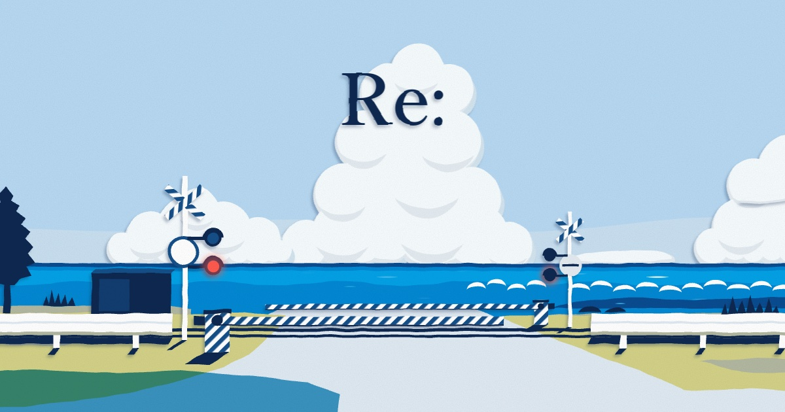

<p align="center"><em>Noon by the sea. The road is empty,<br>and the summer is almost over.</em></p>

# pastelrain

An interactive story you scroll through, drawn in paper-cut scenes of a Japanese seaside town at the end of summer. Live at [pastelrain.com](https://pastelrain.com).

## Stack

- [TanStack Start](https://tanstack.com/start) (React 19, SSR) on Cloudflare Workers
- [Motion](https://motion.dev) for animation and [Lenis](https://lenis.darkroom.engineering) for smooth scrolling
- Tailwind CSS v4
- Scene art is hand-written SVG, with the rough paper edges baked into its geometry. The only images are project screenshots and the social card.
- [Umami Cloud](https://umami.is) for analytics, cookieless and only in production

## Getting started

Requirements: Node ≥ 26.13.1 (see `.node-version`) and pnpm 12 (pinned in `package.json`; Corepack picks it up).

```bash
pnpm install
pnpm dev        # http://localhost:3000
```

## Scripts

| Command                  | What it does                      |
| ------------------------ | --------------------------------- |
| `pnpm dev`               | Dev server on port 3000           |
| `pnpm build`             | Production build into `dist/`     |
| `pnpm preview`           | Serve the production build        |
| `pnpm run deploy`        | Build and `wrangler deploy`       |
| `pnpm generate-routes`   | Regenerate `src/routeTree.gen.ts` |
| `pnpm exec tsc --noEmit` | Typecheck                         |
| `pnpm lint`              | Lint with oxlint                  |
| `pnpm lint:fix`          | Lint and apply fixes              |
| `pnpm format`            | Format with oxfmt                 |
| `pnpm format:check`      | Check formatting                  |

Run this before you push:

```bash
pnpm exec tsc --noEmit && pnpm lint && pnpm format:check && pnpm build
```

Measure performance with a production build (`pnpm build && pnpm preview`).

## Project layout

```
src/
  routes/                 __root.tsx (document shell), index.tsx (the story)
  components/
    scene-kit/            shared: palette, SVG stage, rough shapes, cameras, rushes, scroll tracks
    crossing-scene/       1. the railway crossing and the train
    train-scene/          2. the carriage, the book, the stations
    platform-scene/       3. the platform, the phone, the projects
    beach-scene/          4. the beach, the fireworks, the contacts
    halt-scene/           the not-found and error pages
  styles.css              Tailwind entry, theme, scene animations
```

Content lives in plain data files:

- Story and skills: `src/components/train-scene/story.ts`
- Work history: `stops` in `src/components/train-scene/stations.tsx`
- Projects: `src/components/platform-scene/projects.ts`, with screenshots in `./images/`
- Contacts: `src/components/beach-scene/contacts.ts`

Each scene's scroll length follows from its timeline, so adding a page, stop or project keeps the pace of everything else.

Read `AGENTS.md` before changing the scenes. It covers the architecture and the limits the scenes work within: GPU memory, Safari's filters and the toolbars on phones.

## Commits and releases

Commit messages follow [Conventional Commits](https://www.conventionalcommits.org). A Husky `commit-msg` hook runs commitlint on each commit, and CI lints them again.

CI (`.github/workflows/ci.yml`) runs typecheck, lint, format check and commitlint on pushes to `main` and `dev` and on pull requests. On `main`, semantic-release then bumps the version, writes `CHANGELOG.md` and publishes a GitHub release. It needs a `RELEASE_TOKEN` secret: a repository admin's PAT, since the branch ruleset lets only admins push to `main`.

Cloudflare Workers Builds deploys the site.
